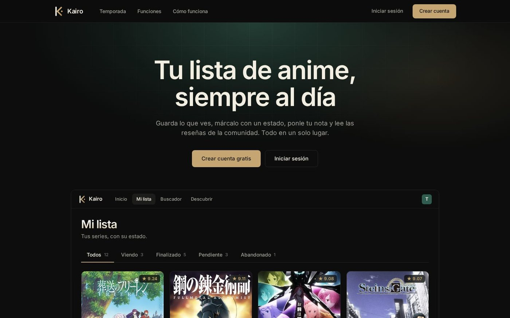
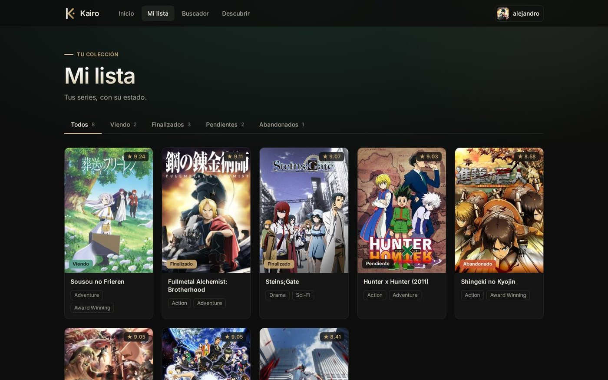
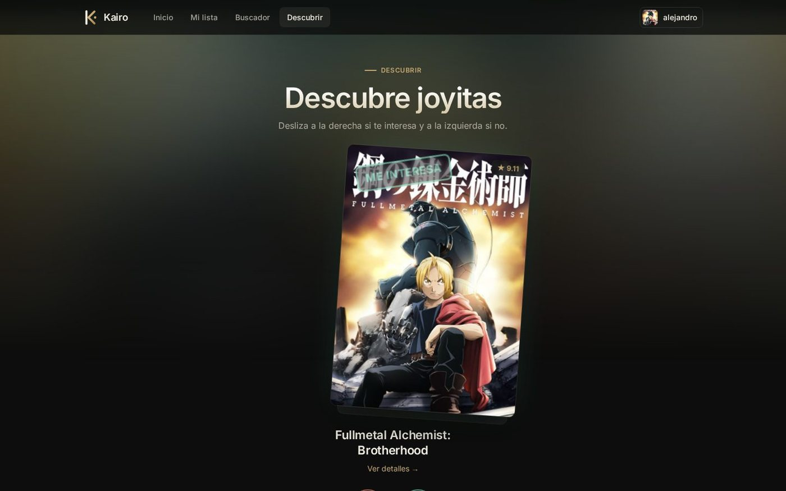
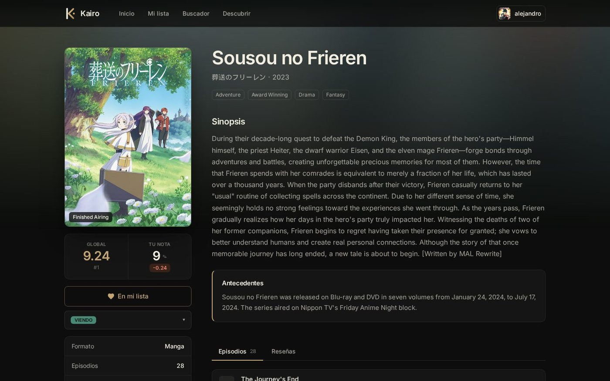
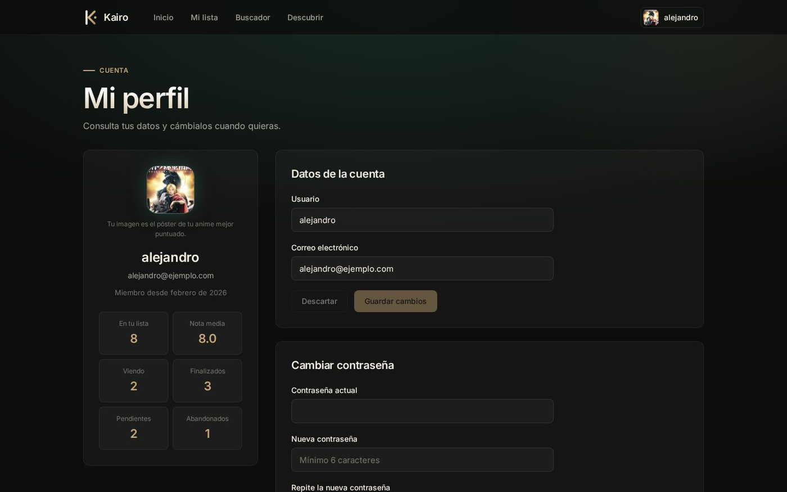

<h1 align="center">Kairo · AnimeWatch Tracker</h1>

<p align="center">
  <b>Busca anime, llévalo al día y puntúalo.</b><br>
  Aplicación web full-stack para el seguimiento personal de anime sobre el catálogo de MyAnimeList.
</p>

<p align="center">
  <a href="https://anime-watchtracker.vercel.app"><b>Demo</b></a> ·
  <a href="https://anime-tracker-opal.vercel.app"><b>API</b></a> ·
  <a href="#capturas">Capturas</a> ·
  <a href="#arranque-en-local">Arranque en local</a>
</p>

<p align="center">
  
  
  
  
  
  
  
  
  
  
</p>

<p align="center">
  
</p>

> La demo corre en el plan gratuito de Vercel: la primera petición tras un rato sin uso puede tardar unos segundos. Puedes crear una cuenta con cualquier usuario y contraseña.

## Qué hace

| | |
|---|---|
| **Landing pública** | Réplica de «Mi lista» con datos reales de la API y la temporada en emisión, con registro e inicio de sesión a un clic |
| **Cuenta segura** | Registro, inicio de sesión con **JWT** y recuperación de contraseña con un código de 6 dígitos por e-mail (guardado con hash, caduca a los 15 min y con límite de intentos) |
| **Buscar y descubrir** | Buscador simple y avanzado (formato, estado, fechas, puntuación), top de temporada, recomendaciones y **Descubrir** con tarjetas que se deslizan: derecha te interesa, izquierda no |
| **Ficha completa** | Sinopsis, géneros, estudios, episodios y reseñas de la comunidad |
| **Mi lista** | Cada serie con su estado (*viendo, finalizado, pendiente, abandonado*) y tu nota; filtros con contadores |
| **Perfil** | Ver y editar usuario y correo, cambiar contraseña y eliminar la cuenta. Tu imagen de perfil es el póster de tu anime mejor puntuado |
| **Contenido apto** | Se filtran las series +18 en listas, buscadores y descubrimiento |

## Capturas

<table>
<tr><td align="center"><br><sub><b>Mi lista</b></sub></td><td align="center"><br><sub><b>Descubrir (deslizar tarjetas)</b></sub></td></tr>
<tr><td align="center"><br><sub><b>Ficha del anime</b></sub></td><td align="center"><br><sub><b>Perfil</b></sub></td></tr>
</table>

## Arquitectura

```
┌──────────────┐  jikan-edge API (catálogo de anime)
│   frontend   │ ───────────────────────────────►
│ Angular :4200│
│              │  HTTP + JWT   ┌─────────────┐  Sequelize  ┌────────────┐
│              │ ────────────► │   backend   │ ──────────► │ PostgreSQL │
└──────────────┘               │ Express:3000│             └────────────┘
                               └─────────────┘
```

| Capa | Tecnologías |
|---|---|
| Cliente | Angular 20 (componentes *standalone*, carga diferida de rutas), TypeScript, CSS propio |
| API | Node.js, Express 5, TypeScript, Sequelize, JWT, bcrypt, express-validator, rate limiting |
| Datos | PostgreSQL (Neon) para usuarios y favoritos · [jikan-edge](https://jikan.lucashdo.com) (API no oficial de MyAnimeList) para el catálogo |
| Despliegue | Vercel (cliente estático y API como función *serverless*) |

## Arranque en local
Necesitas Node.js 20+ y una base de datos PostgreSQL.

```bash
# Backend (http://localhost:3000)
cd backend
cp .env.example .env      # rellena DATABASE_URL y JWT_SECRET
npm install
npm run dev

# Frontend (http://localhost:4200), en otra terminal
cd frontend
npm install
npm start
```

El frontend usa `http://localhost:3000/api` cuando se abre desde `localhost` y el backend desplegado en cualquier otro dominio (`API_URL` en `frontend/src/app/services/auth-service.ts`). Las tablas se crean solas al arrancar el backend (`sequelize.sync`).

### Variables de entorno del backend
| Variable | Para qué |
|---|---|
| `DATABASE_URL` | Conexión a PostgreSQL (con `?sslmode=require` en Neon, Supabase…) |
| `JWT_SECRET` | Firma de tokens |
| `SMTP_HOST`, `SMTP_PORT`, `SMTP_USER`, `SMTP_PASS`, `MAIL_FROM` | Envío del código de «olvidé mi contraseña». Sin ellas, en local el código se muestra por consola |

## Endpoints principales
| Método | Ruta | Acceso |
|---|---|---|
| POST | `/api/auth/register`, `/api/auth/login`, `/api/auth/logout` | público |
| POST | `/api/auth/forgot-password`, `/api/auth/reset-password` | público |
| GET | `/api/auth/user` | autenticado |
| GET · PATCH · DELETE | `/api/user/profile` (ver, editar, eliminar cuenta) | autenticado |
| PUT | `/api/user/password` | autenticado |
| GET · POST | `/api/user/favorites` | autenticado |
| GET · DELETE | `/api/user/favorites/:animeId` | autenticado |
| PATCH | `/api/user/favorites/:animeId/state` · `/score` | autenticado |
| GET | `/api/user/favorite/check/:animeId` | autenticado |

## Estructura
```
animewatch-tracker/
├── frontend/   # Angular 20: páginas (landing, inicio, buscador, descubrir, mi lista, perfil, ficha), componentes y servicios
├── backend/    # Express 5: rutas, controladores, modelos Sequelize, middleware y utilidades (JWT, correo)
└── docs/       # Capturas de pantalla
```

---
<p align="center">Proyecto personal de <a href="https://github.com/Alejandro-Plata">Alejandro Plata Cortés</a> · Datos de series y pósters: MyAnimeList, a través de la API <a href="https://jikan.lucashdo.com">jikan-edge</a>.</p>
